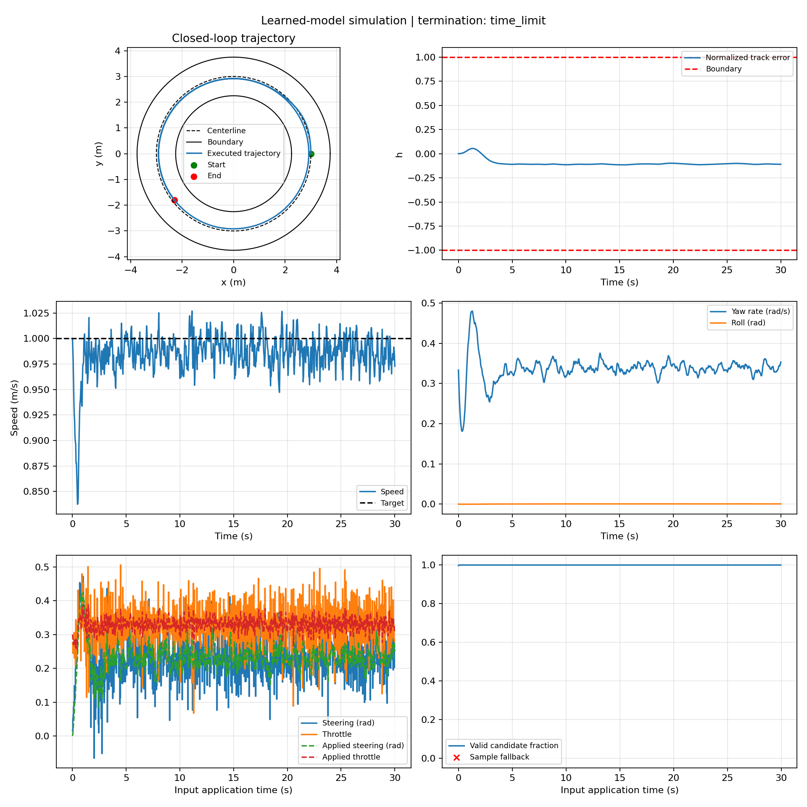
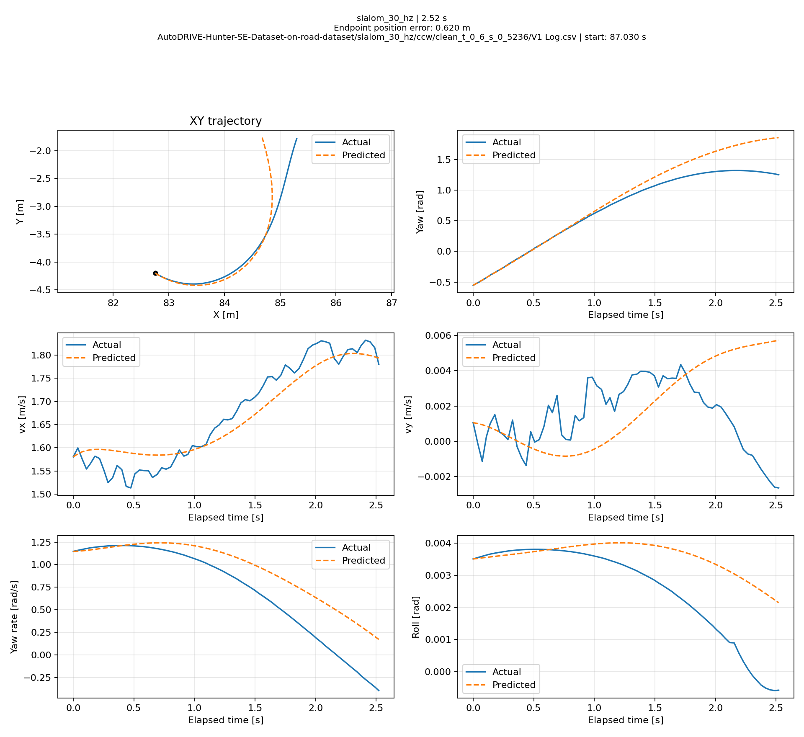
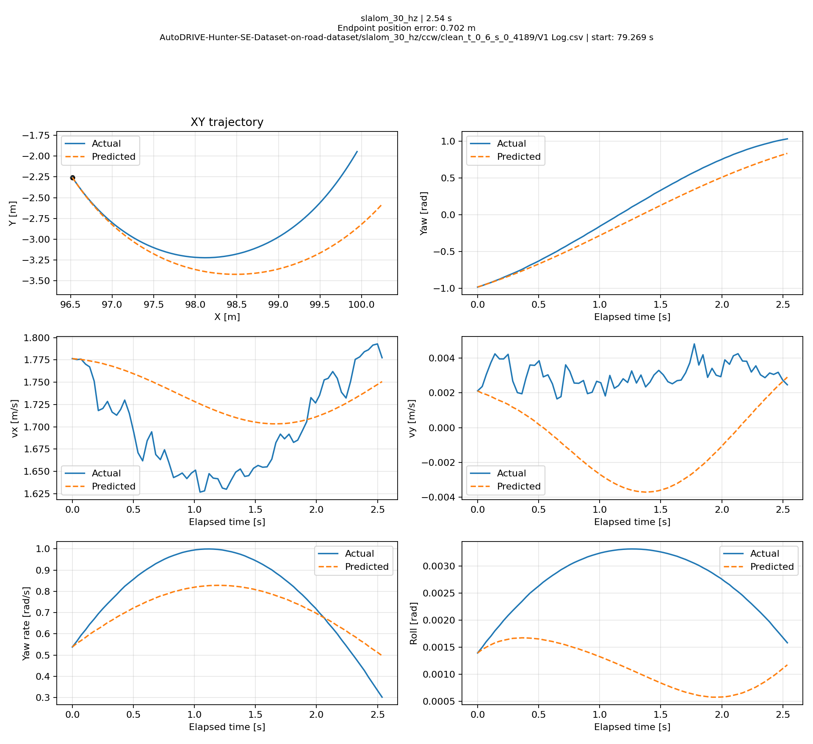
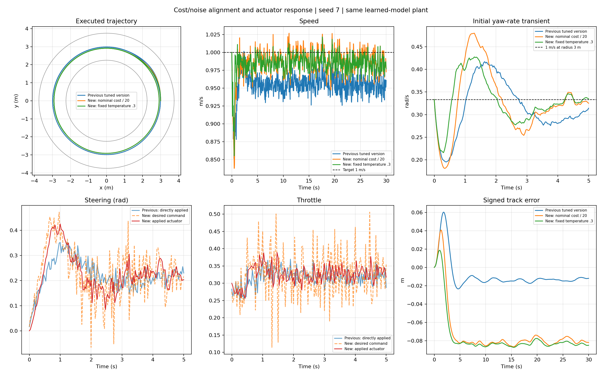

# Bayesian Vehicle Dynamics and MPPI Control (Hunter SE)

**A study of physics-informed Bayesian vehicle dynamics, multi-step prediction, and sampling-based Model Predictive Path Integral (MPPI) control.** Inspired by Williams et al., *Aggressive Driving with Model Predictive Path Integral Control* (ICRA 2016).

> **Scope:** This is an independent educational/research implementation using the public **AutoDRIVE Hunter SE on-road dataset**, not a direct reproduction of the original AutoRally platform or a physical vehicle deployment. The simulated plant and the controller use the **same learned dynamics model**; real-world generalization is **not** established.



## What is implemented

1. **Data preprocessing / system identification:** 30 Hz `straight`, `skidpad`, `fishhook`, and `slalom` logs; smoothing and derivative construction; 7-state model and 2 controls; 25 nonlinear physics-inspired features and four independent Bayesian linear regression models.
2. **Model selection and evaluation:** run-wise train/validation/test splits; per-output predictive negative log-likelihood (NLL) tuning; derivative RMSE/coverage and open-loop rollout position error; experimental 27-feature model with additional steering-rate features and a different hyperparameter selection procedure.
3. **MPPI control:** sampled control sequences, multi-step rollouts through the 25-feature learned model, path/speed/sideslip cost, importance-sampling correction, receding-horizon control updates, actuator lag model, and circular-track closed-loop simulation.

### Vehicle model results: held-out data

For each test window, prediction starts from the measured state and uses recorded future control commands. The metric is **endpoint position RMSE** over successful windows only; failures are listed separately.

| Horizon | 25 features: position RMSE (m) | 27 features: position RMSE (m) | Failures (25 / 27) |
|---|---:|---:|---:|
| 0.5 s | 0.0224 | 0.0383 | 0 / 0 |
| 1.0 s | 0.0757 | 0.1057 | 0 / 0 |
| 1.5 s | 0.1900 | 0.2446 | 1 / 0 |
| 2.0 s | 0.3662 | 0.4795 | 1 / 0 |
| 2.5 s | 0.5826 | 0.8110 | 1 / 0 |

Both models were evaluated on the same 32 test runs; the 2.5 s evaluation contains 5,528 overlapping windows per model. **The two models used different validation/tuning procedures, so this is not a controlled feature-count-only ablation.** See [full results](reports/dynamics_comparison.csv) and the original machine-readable summaries in the respective `trajectory_results/` directories.

| 25-feature example | 27-feature example |
|---|---|
|  |  |

### MPPI: learned-model closed-loop simulation

- **Default setup:** 1,024 sampled trajectories, 75-step horizon (2.5 s at 30 Hz), target speed 1.0 m/s, circular track with radius 3 m and half-width 0.75 m.
- **Example:** seed 7, requested 900 simulation steps (30.0 s), completed; track-centerline RMSE **0.0771 m** and speed tracking RMSE **0.0251 m/s**.
- **Three-seed check:** seeds 7/8/9 all completed 30.0 s; mean track RMSE **0.07744 m**, mean speed RMSE **0.02359 m/s**. These refer only to the same-model simulation.
- **Tradeoff:** compared with a previous controller/plant configuration, the current version improved speed RMSE but increased track RMSE. The actuator model changed, so the difference is not attributable to a single algorithmic change.
- **Not real-time:** one CPU command can take longer than the simulated 33.3 ms control interval. No physical vehicle, independent vehicle plant, or strict reproduction claim is made.



## Project structure

```text
basis25_nll/
    dynamics.py             # 25-feature BLR, preprocessing, model I/O
    train_dynamics.py       # run-wise splits, validation NLL tuning
    test_dynamics.py        # held-out derivatives and multi-step rollout
    trained_model/          # trained .npz checkpoint and split manifest
    trajectory_results/     # selected test metrics (no raw large windows)
basis27_multistep/          # experimental, not used by MPPI
mppi/
    config.py
    dynamic_adaptor.py      # 25-feature checkpoint + actuator state interface
    controller.py           # sampling, scoring, importance weighting
    simulator.py            # circular track / simulated plant
    run.py                  # CLI, plots, metrics
    test_mppi.py            # unit tests
    FORMULATION.md          # deviations/assumptions for the controller
    results/paper_alignment/  # selected comparison/report artifacts
docs/figures/               # selected visuals
reports/                    # reduced results, assumptions, validations
requirements.txt
```

## Quick start (without downloading the training data)

Python **3.10+** is required.

```bash
python -m pip install -r requirements.txt
python -m unittest mppi.test_mppi -v
python -m mppi.run --steps 30 --samples 64
```

For the recorded longer-horizon example (CPU time can be substantially longer than 30 seconds of *simulation*):

```bash
python -m mppi.run --steps 900 --samples 1024 --seed 7
```

The MPPI command loads `basis25_nll/trained_model/dynamics_model.npz` by default; the original full driving dataset is **not necessary** for these demonstration simulations.

## Dataset acquisition and rerunning model training

Download the **on-road-dataset branch** from **[Tinker-Twins / AutoDRIVE-Hunter-SE-Dataset](https://github.com/Tinker-Twins/AutoDRIVE-Hunter-SE-Dataset/tree/on-road-dataset)** and place/rename its ZIP file as:

```text
data/AutoDRIVE-Hunter-SE-Dataset-on-road-dataset.zip
```

The ZIP must contain the original 30-Hz maneuver folders and the `V1 Log.csv` files, which the loader expects. The `data/` directory is excluded from Git. The original data is distributed under **BSD-2-Clause** at its upstream repository; cite the dataset authors and respect its terms if you choose to redistribute it separately.

```bash
python basis25_nll/train_dynamics.py --data data/AutoDRIVE-Hunter-SE-Dataset-on-road-dataset.zip
python basis25_nll/test_dynamics.py --data data/AutoDRIVE-Hunter-SE-Dataset-on-road-dataset.zip
# Optional experimental model:
python basis27_multistep/train_dynamics.py --data data/AutoDRIVE-Hunter-SE-Dataset-on-road-dataset.zip
python basis27_multistep/test_dynamics.py --data data/AutoDRIVE-Hunter-SE-Dataset-on-road-dataset.zip
```

**Warning:** Re-training changes the checkpoint used by the MPPI simulation. Back up the supplied checkpoints if you want to retain the recorded experimental settings/results. Default training and complete test evaluations may take considerable CPU time.

## Reproduction scope and caveats

- **2016 ICRA paper:** it reports 24 nonlinear basis functions but does not list them completely. This implementation uses its **own 25-feature and 27-feature variants**, informed in part by the related 2019 dissertation, and different Hunter SE data.
- **Current MPPI:** receding-horizon rollout and importance-sampling structure is implemented, with documented practical deviations (sampling variance, temperature normalization, track-exit handling, deterministic mean-model rollout, actuator dynamics). Details: [FORMULATION](mppi/FORMULATION.md).
- **Verification:** run-wise held-out model evaluations differ from the closed-loop MPPI simulator. The simulator's *plant is not independent of the predictor*; results may overestimate real-world performance.
- **Selected results:** the prior `importance_experiment/` logs used a different old correction coefficient and are intentionally not bundled or represented as current-controller output.
- **License:** this repository contains original implementation code and third-party dataset citations, but no license has been chosen for the code in this release; project owner should decide before public licensing.

A longer discussion of assumptions is in [METHODS_AND_LIMITATIONS](reports/METHODS_AND_LIMITATIONS.md).

## References and dataset credits

- G. Williams, P. Drews, B. Goldfain, J. M. Rehg, and E. A. Theodorou, “Aggressive Driving with Model Predictive Path Integral Control,” **ICRA**, 2016. [DOI:10.1109/ICRA.2016.7487277](https://doi.org/10.1109/ICRA.2016.7487277).
- G. R. Williams, *Model Predictive Path Integral Control: Theoretical Foundations and Applications to Autonomous Driving*, PhD dissertation, Georgia Tech, 2019. [Repository](https://repository.gatech.edu/entities/publication/7ca91cea-ee94-4751-9b53-54dc7a542a38).
- Tinker-Twins, **AutoDRIVE Hunter SE Dataset**, `on-road-dataset` branch, BSD-2-Clause license. [GitHub source](https://github.com/Tinker-Twins/AutoDRIVE-Hunter-SE-Dataset).
- T. Samak et al., “AutoDRIVE: A Comprehensive, Flexible and Integrated Digital Twin Ecosystem for Autonomous Driving Research & Education,” *Robotics*, 12(3), 77, 2023. [DOI](https://doi.org/10.3390/robotics12030077).
